


 

 

<!-- ───────────────────────── 01 ABOUT ───────────────────────── -->

<table>
<tr>
<td width="58%" valign="middle">

👋 Hi there, I'm **Mohammad Saad**, a **Full Stack Developer** who loves turning 💡 ideas into reality with code.

- 🎮 I build **games**, 📱 **apps** and sleek **web experiences**
- 🤖 I dabble in **machine learning** and **hardware** (Arduino)
- 🧊 I love **3D**, from game engines to Blender and Maya
- 🔥 **Firebase** is my backend buddy
- 🌱 Always learning, always shipping
- 💬 Open to **collaboration**, so let's build cool stuff together!

> *"Precision of a watchmaker, imagination of an architect, power of code."*

🧭 **Walk through my 3D portfolio:** [mohammadsaad112.vercel.app](https://mohammadsaad112.vercel.app/)

</td>
<td width="42%" align="center" valign="middle">


</td>
</tr>
</table>

 

<!-- ───────────────────────── 02 TECH ARSENAL ───────────────────────── -->


 

<!-- ───────────────────────── 03 WHAT I BUILD ───────────────────────── -->


 

<!-- ───────────────────────── 04 GITHUB STATS ───────────────────────── -->

 

<!-- ───────────────────────── SNAKE ───────────────────────── -->
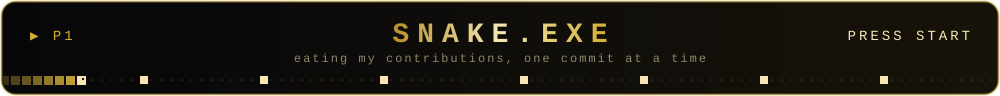

<picture>
  <source media="(prefers-color-scheme: dark)" srcset="https://raw.githubusercontent.com/mohammadsaad006/mohammadsaad006/output/github-snake-dark.svg" />
  <source media="(prefers-color-scheme: light)" srcset="https://raw.githubusercontent.com/mohammadsaad006/mohammadsaad006/output/github-snake.svg" />
  
</picture>

 

<!-- ───────────────────────── 05 CONNECT ───────────────────────── -->

<!-- Replace every YOUR_... below with your real link -->

 

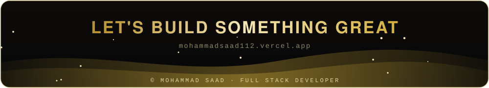
